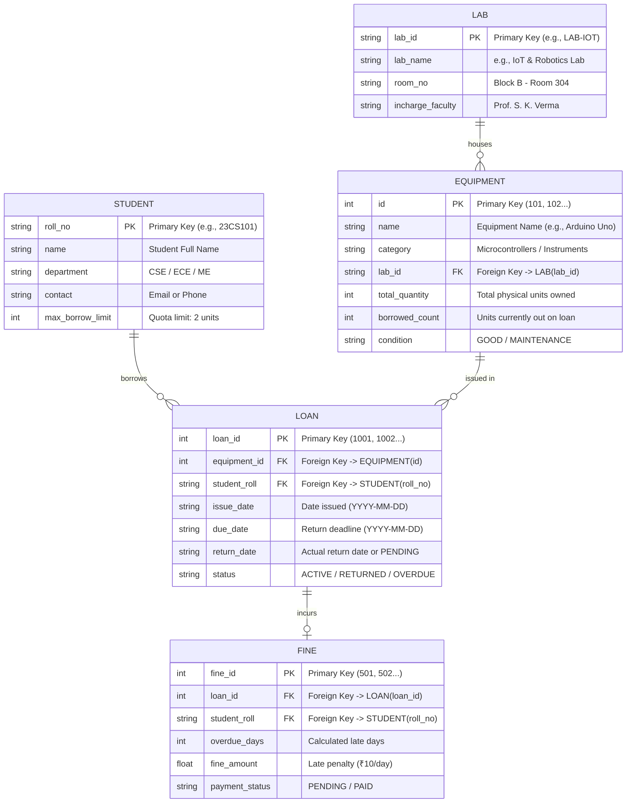

# Entity-Relationship (ER) Diagram & Relational Schema Specification

**System:** Campus Lab Equipment Borrowing System  
**Architecture:** 3-Tier Normalized Relational System (3NF)  
**Database Tables:** `labs.txt`, `students.txt`, `equipment.txt`, `loans.txt`, `fines.txt`

---

## 1. Visual Entity-Relationship Diagram (Mermaid)



---

## 2. Text/ASCII Diagram (For Viva Whiteboard Drawing)

```
  +------------------+
  |       LAB        |
  +------------------+
  | PK  lab_id       | 1
  |     lab_name     |
  |     room_no      |
  |     faculty      |
  +--------+---------+
           |
           | houses (1:N)
           v
  +------------------+                   +------------------+
  |    EQUIPMENT     |                   |     STUDENT      |
  +------------------+                   +------------------+
  | PK  id           | 1               1 | PK  roll_no      |
  |     name         |                   |     name         |
  |     category     |                   |     department   |
  | FK  lab_id       |                   |     contact      |
  |     total_qty    |                   |     max_limit    |
  |     borrowed_cnt |                   +--------+---------+
  |     condition    |                            |
  +--------+---------+                            | borrows (1:N)
           |                                      |
           | loaned in (1:N)                      |
           +------------------+  +----------------+
                              |  |
                              v  v
                     +-------------------+
                     |       LOAN        |
                     +-------------------+
                     | PK  loan_id       | 1
                     | FK  equipment_id  |
                     | FK  student_roll  |
                     |     issue_date    |
                     |     due_date      |
                     |     return_date   |
                     |     status        |
                     +---------+---------+
                               |
                               | incurs (1:0..1)
                               v
                     +-------------------+
                     |       FINE        |
                     +-------------------+
                     | PK  fine_id       |
                     | FK  loan_id       |
                     | FK  student_roll  |
                     |     overdue_days  |
                     |     fine_amount   |
                     |     payment_status|
                     +-------------------+
```

---

## 3. Relational Schema & Cardinalities

### 1. `LAB` $\rightarrow$ `EQUIPMENT` ($1 : N$)
* One physical lab room houses multiple equipment items.
* Every equipment item is assigned to exactly one lab.
* **Referential Integrity:** `EQUIPMENT.lab_id` references `LAB.lab_id`.

### 2. `STUDENT` $\rightarrow$ `LOAN` ($1 : N$)
* A student can borrow multiple equipment units over time.
* **Business Rule:** A student cannot exceed their `max_borrow_limit` (default: 2 active items).

### 3. `EQUIPMENT` $\rightarrow$ `LOAN` ($1 : N$)
* A single equipment kit (e.g. `Arduino Uno #101`) can have multiple borrowing records across semesters.
* **Business Rule:** Cannot issue an item if `available_quantity <= 0` or `condition == 'MAINTENANCE'`.

### 4. `LOAN` $\rightarrow$ `FINE` ($1 : 0..1$)
* On-time returns incur zero fines.
* Overdue returns automatically trigger exactly one fine record calculated at **₹10 per day late**.

---

## 4. Normalization Justification (Third Normal Form - 3NF)

When faculty asks: *"Is your database normalized?"*, answer:
1. **First Normal Form (1NF)**: Every cell contains an atomic value. No repeating groups or arrays are stored in a single column.
2. **Second Normal Form (2NF)**: All non-key attributes are fully functionally dependent on the Primary Key. (e.g. Student name depends only on `roll_no`, not on `loan_id`).
3. **Third Normal Form (3NF)**: No transitive dependencies exist. Lab room location depends on `lab_id`, not embedded inside the `equipment` table. Student contact depends on `roll_no`, not in the `loan` table.
